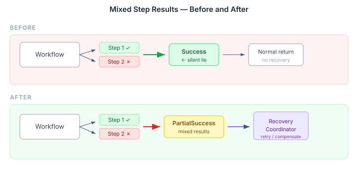
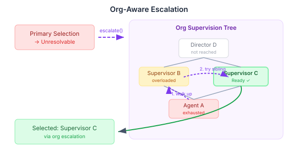

# The Gap Between Completion and Success

A workflow that finishes without throwing isn't the same as a workflow that succeeded. That distinction sounds obvious when stated plainly, but workflow engines routinely conflate the two — and the consequences are silent.

CaseHub's `FlowWorkerFunctionHandler` had exactly this problem. A Serverless Workflow playbook runs multiple steps. Each step records its own status — `SUCCEEDED`, `FAILED`, or `SKIPPED`. If the workflow handles errors internally (retries a step, catches an exception, continues on a branch), it completes normally. The handler collects the step results, wraps them in `PlaybookExecutionResult.Success`, and returns.

The problem: the handler never checked the step results. A playbook where step 1 succeeded and step 2 failed was reported identically to one where everything worked. The `Success` result carried the failed steps as data, but the engine's recovery machinery — `RetryOrchestrator`, `RecoveryCoordinator` — only activates when it sees a `Failure` or `PartialSuccess`. A `Success` with embedded failures sailed past every safety net.



The fix is five lines. After collecting the step results, check whether any have `FAILED` status:

```java
boolean hasFailedSteps =
    steps.stream().anyMatch(s -> s.status() == StepStatus.FAILED);
if (hasFailedSteps) {
    throw new PlaybookExecutionException(
        "Partial success: some steps failed", null,
        new PlaybookExecutionResult.PartialSuccess(outputMap, steps));
}
```

`PartialSuccess` already existed in the API — designed for this exact scenario, never produced. The type was waiting for its single call site. Now the recovery path fires, and mixed results get the attention they need: retry the failed steps, compensate, or escalate to a human.

This pattern — the type that exists but is never produced — is worth watching for. It often means the design anticipated the problem but the implementation took the optimistic path.

## When Nobody Can Handle It

A related gap existed in agent selection. CaseHub's `EngineAwareAgentSelector` matches capabilities to agents: given a task requiring "kyc-verification", find an agent that can do it. When the routing strategy returns `Unresolvable` (no viable candidates) or `Escalated` (borderline stalemate), the selector returned that result directly. Dead end.

But organisations have escalation paths. When your immediate team can't handle a task, it goes up the chain. CaseHub's eidos module models these structures — `OrgAwareDispatch.escalate()` walks the supervision tree, checking each agent's capability health until it finds one that's ready.



The wiring is straightforward. Before returning `NoneQualified` or `Escalated`, try the org chain:

```java
private AgentSelection tryEscalation(
    List<CandidateMapping> mappings,
    SelectionContext context,
    AgentSelection fallback) {
  if (orgDispatch.isEmpty() || mappings.isEmpty()) {
    return fallback;
  }
  String agentId = mappings.getFirst().candidate().workerId();
  return orgDispatch.get()
      .escalate(agentId, context.capabilityName(), context.tenancyId())
      .map(match -> (AgentSelection) new AgentSelection.Selected(
          match.descriptor(), match.resolvedCapability(),
          lookupTrustScore(match.descriptor().agentId(),
                           context.capabilityName()),
          "org escalation from " + agentId))
      .orElse(fallback);
}
```

When no org structure exists — `OrgAwareDispatch` isn't deployed, or the escalation path is exhausted — the `Optional` returns empty and behaviour is unchanged. Zero impact on deployments that don't use organisational modelling. For those that do, the selector now mirrors how human organisations actually work: try the team first, escalate if stuck.

## Making the Pipeline Visible

The third change is less about runtime honesty and more about external visibility. CaseHub's mosaic gallery — the visual tool for browsing agent configurations and coordination pipelines — was running on hand-crafted JSON fixtures. Real definitions existed in the engine, but no projection path connected them to the gallery's data model.

We added two `@McpDomain` query endpoints: `getAgentDescriptors` projects worker definitions enriched with eidos agent metadata (disposition, capabilities, goals), and `getCoordinationPipeline` extends the existing pipeline projection with routing, drill-down, and visual metadata that the gallery components need. When eidos is absent, workers still project — just with thinner descriptors.

## The Common Thread

All three changes address the same underlying problem: the gap between what the system knows and what it tells you. A workflow knows which steps failed — but reported success anyway. The selector knew about org structures — but didn't consult them. The engine had real definitions — but the gallery couldn't see them.

Each fix was small. The `PartialSuccess` type already existed. The `OrgAwareDispatch` contract was already deployed. The `CoordinationPipelineProjection` was already projecting most of the data. The wiring was missing, not the capability.

That's the pattern worth internalising: the expensive part of building systems isn't usually the missing capability. It's the missing connection between capabilities that already exist.
