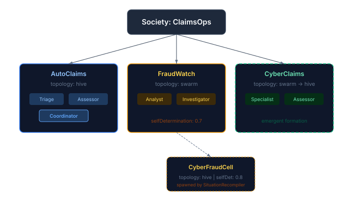
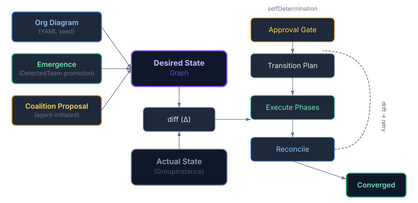

Most multi-agent systems treat agents like interchangeable workers in a pool. Drop them in, let them run, hope something useful happens. The coordination — if you can call it that — is either hardwired by the developer or left entirely to chance.

That works for demos. It doesn't work for anything you'd actually deploy.

Real enterprises have structure. Teams form around problems. Those teams have roles — someone coordinates, someone investigates, someone reviews. The structure changes when the problem changes. And nobody stops the assembly line to reconfigure it by hand.

We've been building exactly this into CaseHub. Not a fixed org chart bolted onto agents, but a dynamic society where groups form, adopt coordination patterns, enforce policies through roles, and restructure themselves when conditions change — all at runtime, governed by how much autonomy you give them.

## The academic grounding

I didn't want to invent a new organisational model from scratch. The multi-agent systems community solved this decades ago.

[MOISE+](https://moise.sourceforge.net/doc/publications/Hubner-sbia2002.pdf) (Hübner, Sichman, and Boissier, 2002) decomposes organisation into three dimensions: structural (who belongs where, what roles exist), functional (what goals the group pursues), and deontic (which roles are obligated or permitted to pursue which goals). It's clean. It maps directly to what you actually need at runtime.

[AGR](https://www.madkit.net/madkit/docs/articles/FromAgentstoOrganizations_AAMAS03_FerbGutMich.pdf) (Ferber, Gutknecht, and Michel, 2003) gives the primitives: Agent, Group, Role. Three concepts. Groups can nest. Agents can be in multiple groups. Roles constrain behaviour within groups.

CaseHub's model draws from both. One concept — Group — that composes recursively. The root is the Society. Leaves are teams. Depth is unconstrained. Each group has four facets:

- **Identity** — who it is, where it sits in the hierarchy
- **Topology** — how its members coordinate (swarm, hive, mesh, or independent)
- **Policy** — what roles exist, what obligations and permissions each carries
- **Roles** — which agents currently hold which roles, adopted and released at runtime

## Topology isn't a label — it's how the group thinks

The distinction between a swarm and a hive isn't cosmetic. It determines the coordination mechanism the runtime activates.

A **swarm** coordinates through stigmergy — agents deposit signals in a shared environment and observe what others have deposited. No central coordinator. No directed messages. Each agent acts independently based on local information, and coherent behaviour emerges. CaseHub's stigmergy package has been doing this for months.

A **hive** is structured. Roles are assigned: coordinator, planner, builder, critic. The coordinator routes work, members report through a private channel, and the orchestration patterns — supervisor, debate, voting — govern how decisions get made. The key insight: we didn't build "Hive" as a separate thing. Hive is what you get when you take a group and configure it with roles, policy, and orchestration patterns that already exist in the agency layer.

A **mesh** is peer-to-peer messaging through Qhorus channels — consensus, relay, federation. The connective tissue between groups.

And **many** is just parallel execution with no coordination at all — agents sharing a policy and organisational identity without the overhead of coordinating.

Topology is mutable. A group that starts as a swarm (agents clustering around shared signals) can transition to a hive (adopting roles and structured coordination) once it stabilises. The `selfDetermination` property — a value between 0 and 1 on each group — governs how freely it can make that transition. Low values require external approval. High values let the group self-govern.

## Three ways to form a group

Groups come into existence through three paths, all producing the same runtime structure:

**Top-down** — an operator declares the group in a YAML diagram. This is how you seed an initial organisation at deployment time. CaseHub's eidos layer loads the diagram, and the desired-state reconciliation loop provisions everything.

**Emergence** — CaseHub's swarm engine detects that agents are naturally clustering (shared interests, complementary capabilities, co-active signal patterns). When a detected cluster stabilises — it persists across enough detection cycles — the society runtime promotes it to a real group with its own identity, topology, and policy.

**Bottom-up proposal** — agents themselves propose forming a group. An agent creates a coalition proposal (I need these capabilities, I suggest these members), the system evaluates coverage, proposed members negotiate through a Qhorus channel, and on acceptance the group is created.

`selfDetermination` controls which paths are available. A group with a low value can only be formed top-down. A highly autonomous group allows emergence and proposals without external approval.

## Infrastructure-as-code for organisational structure

This is where the design gets interesting.

Every group mutation — formation, dissolution, topology change, membership change — goes through the desired-state reconciliation loop. You don't imperatively say "move agent X to group Y." You declare the target organisational structure, and the system figures out the transition.

An org diagram is a desired-state goal specification. The same mechanism handles initial deployment (empty → diagram A), restructuring (diagram A → B), scaling (add more agents), recovery (drift detected → reconcile back), and rollback (diagram B failing → reapply A). The diagrams are YAML files — versioned, diffable, auditable.

The practical consequence: emergent formation and top-down restructuring use the same path. When a swarm detects a stable team and promotes it, that's the runtime editing the desired-state graph. When an operator provides a new YAML diagram, that's also editing the desired-state graph. Same reconciliation loop. Same approval gates. Same drift detection. Same fault recovery.

`selfDetermination` maps directly to the approval policy. An agent-proposed group in a highly autonomous society auto-approves. The same proposal in a tightly governed society requires explicit approval before it takes effect.

## What this actually looks like

Consider an insurance claims processing operation. Three groups: AutoClaims (hive topology, tightly governed), HomeClaims, and FraudWatch (swarm topology, highly autonomous).

A new cyber-insurance product launches. Claims volume spikes 400% in 48 hours. No CyberClaims group exists.

The desired-state system compiles a new target: shrink AutoClaims (volume dropped 30%), create CyberClaims, expand FraudWatch. The transition planner produces a phased plan: form the new group first, then migrate agents, then stabilise the topology. `selfDetermination` gates each step — AutoClaims (0.3) requires approval to shrink, FraudWatch (0.7) auto-approves expansion.

Mid-migration, agent A3 is processing an active claim. The reconciliation loop detects drift — A3 should be in CyberClaims but is still busy in AutoClaims. Fault policy kicks in: provision a substitute, mark A3 as pending-drain, keep checking each cycle until the claim completes.

72 hours later, FraudWatch's swarm detects consensus — cyber claims have triple the fraud rate. The situation recompiler fires: spawn a CyberFraudCell sub-group with hive topology and high autonomy. New transition plan. New approval gate. The system restructures around a problem it discovered on its own.

## Where it sits

The architecture spans five repos, each with a clear responsibility:

- **eidos** — the model layer. Types, storage, SPIs. Defines what a group IS.
- **qhorus** — communication. Channel visibility (public, private, direct) gives groups their internal and inter-group messaging.
- **desiredstate** — the orchestration layer. Compiles org diagrams, diffs desired vs actual, plans transitions, detects drift, recovers from faults. Owns the GroupLifecycleService implementation.
- **engine** — the runtime. Swarm detection, stigmergy coordination, topology-aware provisioning. Emits events; doesn't manage groups directly.
- **agency** — the intelligence layer. Coalition proposals, negotiation protocols, orchestration patterns (supervisor, debate, voting). The deliberation that makes Hive groups actually coordinate.

Each layer depends only on what's above it. No circular dependencies. Engine doesn't know about desired-state. Agents propose groups through an SPI that eidos defines and desired-state implements. The system holds together through interface contracts, not tight coupling.

## What this opens up

The society model isn't just organisational bookkeeping. It's the foundation for agent systems that adapt their own structure to changing conditions.

A group that detects diminishing returns on its current approach can transition its topology — from hive (structured) to swarm (exploratory) and back. A group that recognises complementary capabilities in a neighbouring group can propose a merge. A society that sees coordination storms — too many signals, not enough convergence — can spawn specialist sub-groups to absorb the load.

None of this requires a human to intervene. The `selfDetermination` dial controls how far it can go autonomously, and the desired-state reconciliation loop ensures every change is planned, approved (or auto-approved), executed in phases, and recoverable if something goes wrong.

The gap between a collection of agents and an agent society is structure. Not structure imposed from outside, but structure that emerges, adapts, and governs itself.
