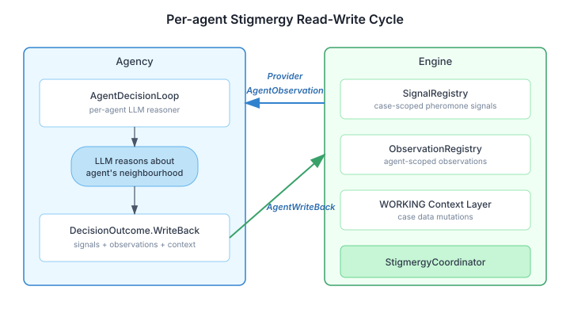

# Closing the Stigmergy Loop

A few weeks ago I wrote about giving swarms a nervous system — `SwarmCoordinationListener` bridging engine's internal coordination events to agency. That solved one direction: engine tells agency what happened. But the data plane was still one-way. Agency's per-agent LLM decision loop could hear that roles changed or convergence was reached, yet it couldn't see the signal landscape that led to those conclusions. And it couldn't write anything back.

This is like giving someone a phone where they can hear the other side but can't speak. You can react to events, but you can't participate in the environment that produces them.

## The gap in practice

CaseHub's stigmergy model follows the biological metaphor closely. Agents deposit pheromone-like signals into a shared environment. Other agents perceive those signals and adjust their behaviour. `SignalRegistry` handles the deposit-decay-perceive physics. `ObservationRegistry` tracks what each agent has noticed. `StigmergyCoordinator` detects emergent patterns — signal consensus, interest convergence, coordination storms.

All of this is engine-internal. The classes live in `common-core` under an `internal` package. Agency can't touch them — and shouldn't. The module boundary is correct. But agency's per-agent LLM decision loop (`AgentDecisionLoop`) needs exactly this data to reason about each agent's local neighbourhood. Without it, the LLM builds prompts from stale context and makes decisions blind to the pheromone trails other agents are leaving.

`DecisionOutcome.WriteBack` already modelled what the LLM wants to produce — signal deposits, observations, context mutations. The sealed interface existed. Nothing executed it. The write-back was a dead letter.

## Why signals stay case-scoped

The issue originally proposed per-agent signal filtering — each agent sees only signals matching its declared interests or team membership. I rejected this after thinking through the stigmergy model from first principles.

Stigmergy's power IS the shared environment. Ants don't have private pheromone channels. Every ant perceives every trail. The coordination emerges from the collective response to shared information, not from information hiding. Per-agent filtering turns stigmergy into messaging — a fundamentally different coordination model.

If the LLM context window is too small for all the signals, that's agency's problem to solve. Agency knows its context budget. Agency knows the agent's role. Agency decides what to prioritise. The engine provides the full environmental picture. Giving the engine filtering responsibility would couple it to LLM context constraints it has no business knowing about.

Observations are different. They're inherently agent-scoped — things a specific agent noticed. The API reflects this: `perceiveSignals(UUID caseId)` returns the full signal landscape, `observations(UUID caseId, String agentId)` returns only what that agent recorded.

## Two SPIs, not one

The read path and write path serve different lifecycle moments. The decision loop reads state to build a prompt, then writes state after the LLM responds. Different consumers might need only one — a monitoring system wants to read without writing, a replay tool wants to write without reading. Interface Segregation applies.

`AgentObservationProvider` handles reads. `AgentWriteBack` handles writes. The naming is deliberate — the write SPI is called `AgentWriteBack` rather than `StigmergyWriter` because one of its three methods (`writeContext`) writes to the case's WORKING context layer, not to the stigmergy environment. Naming it after stigmergy would be a lie.

The default implementations delegate to the existing registries. `DefaultAgentObservationProvider` calls `SignalRegistry.perceive()` and `ObservationRegistry.getObservations()`. `DefaultAgentWriteBack` calls `SignalRegistry.deposit()` with the agent as the source, and uses a read-append-write pattern for observations (the underlying `storeObservations` has replace semantics — without the lock, concurrent write-backs silently overwrite each other).

## Attribution closes the loop

Signals already carry their depositor identity — `Signal.sources()` tracks every agent that deposited or reinforced a signal. But `PerceivedSignal`, the read model, only exposed `lastSource`. The LLM seeing "signal URGENT_TRIAGE has strength 0.8, last deposited by agent-3" is far less informed than "deposited by agents 1, 3, and 5." The difference between seeing one contributor and seeing consensus is the difference between ignoring a signal and acting on it.

We added `sources: Set<String>` to `PerceivedSignal`. Pre-release project, zero compatibility cost, and it transforms the signal from a scalar data point into a social signal.

The same attribution gap existed in coordination events. `SIGNAL_CONSENSUS` already included `sources` in its metadata, but `INTEREST_CONVERGENCE` only reported a count — how many agents were watching a hotspot, not which ones. Now it includes the full set. An LLM reasoner can tell its agent "your teammates are all watching the same key" rather than "some agents are watching the same key."

## What this unlocks

With these SPIs in place, agency's `DistributedTopology` can wire up the full per-agent reasoning loop. Each agent in a swarm gets its own lightweight LLM decision loop that reads the signal landscape, understands what its peers are doing through attribution data, reasons about its local neighbourhood, and writes its decisions back into the shared environment for others to perceive.

This is genuine distributed stigmergic coordination — not a central controller dispatching instructions, but autonomous agents coordinating through a shared medium. The engine provides the environment and the physics. Agency provides the intelligence. The SPIs are the membrane between them.
