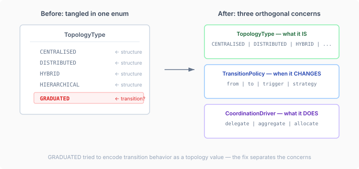

# The enum value that was three things

`TopologyType` is one of those enums the engine switches on everywhere. `CENTRALISED`, `DISTRIBUTED`, `HYBRID`, `HIERARCHICAL` — each value answers a single question: what is the topology's structure? That question determines authority derivation, role validation, and which structural roles are legal. Clean, mechanical, exhaustive.

Then there was `GRADUATED`.

GRADUATED's `deriveAuthority()` implementation was identical to HYBRID's — accepts all three structural roles, returns the same authority mapping. No unique mechanical behavior. It existed because someone needed to express "this topology starts centralised and migrates to distributed as the swarm matures." Which is a real concept. But it's not a topology type.

It's a transition policy.

## What went wrong

The coordination vocabulary spec from two weeks ago caught this explicitly: "GRADUATED is a transition policy, not a topology value." The design review removed it from the spec. But it survived in the code — and the reason it survived is instructive.

When you're building a vocabulary for a new domain, there's a gravitational pull toward putting everything in the first type you create. TopologyType existed. It had `deriveAuthority()`. Adding GRADUATED was a one-line change that made the concept visible. The alternative — a separate type, a separate SPI, separate tests — felt heavyweight for what seemed like a simple idea.

The problem surfaces later. GRADUATED says the topology *will change*, but TopologyType is consumed by code that assumes the value is stable. `TopologyDescriptor` validates agent roles against the topology type at construction time. If the type changes, every descriptor in the system needs reconstruction. That's not wrong — it's just a signal that the change belongs somewhere else, with its own lifecycle.



## The separation

Three concerns that were getting tangled:

**What the topology IS** — `TopologyType`. An enum. CENTRALISED, DISTRIBUTED, HYBRID, HIERARCHICAL. Each value mechanically determines which structural roles are valid and what authority they derive. This is stable during a topology's lifetime.

**When and how the topology CHANGES** — `TransitionPolicy`. A record carrying a source topology, target topology, trigger condition, execution strategy, and optional rollback. The trigger is a sealed interface — `Threshold` (a named metric crossing a value), `Time` (a duration elapsed), or `Convergence` (a normalised score). The strategy is either `IMMEDIATE` (one-step) or `PHASED` (the provider decides the mechanics). These live on `TopologyProvider` as default methods: `transitionPolicy()` returns the configured policy, `evaluateTransition()` returns whether a transition should fire now.

The existing `onTopologyChanged` hook on `AgentWorkLifecycleListener` is the notification side. The new methods are the decision side. Both existed before — what was missing was the model that connects them.

**What the coordinator DOES** — `CoordinationDriver`. An SPI with four methods: `delegate` (assign work to agents within the topology), `aggregate` (combine their outputs), `allocate` (select eligible agents for a task), and `onLifecycleEvent` (react to starts, stops, reconfigurations). This follows the same two-layer pattern as SUPERVISOR's contract: `CoordinatorBehavior` marker interface in `model.coordination`, `CoordinationDriver` SPI in `spi.coordination`, `NoOpCoordinationDriver` default in `runtime-core`.

```java
public interface CoordinationDriver extends CoordinatorBehavior {
  List<DelegationAssignment> delegate(
      CoordinationTask task, TopologyDescriptor topology);
  CoordinationResult aggregate(
      List<DelegationOutcome> outcomes, CoordinationTask originalTask);
  List<String> allocate(
      CoordinationTask task, TopologyDescriptor topology);
  void onLifecycleEvent(CoordinationLifecycleEvent event);
}
```

Until now, `PlatformRole.COORDINATOR` was a vocabulary value with no engine-level behavioral contract. The behavior lived in agency's `OrchestratedDriver` — locked in a consumer repo. If the platform claims it implements behavior for a role, the contract should be an engine SPI. Otherwise PlatformRole is just an enum with aspirational names.

## The cross-repo surprise

One thing I didn't anticipate: removing GRADUATED from TopologyType broke agency's `GraduatedTopology.java`, which references `TopologyType.GRADUATED` directly. A cross-repo consumer I hadn't checked before making the change.

The fix is `@Deprecated(forRemoval = true)` with delegation to HYBRID — which has identical behavior, so nothing changes mechanically. The agency migration happens when agency adopts `TransitionPolicy` as the replacement. Claude caught this during the rebase — the IntelliJ build showed the symbol error in agency-core, which is on the workspace classpath even though it's a separate repo.

## What this enables

`TransitionPolicy` means a topology can describe its own graduation rules declaratively. A swarm that starts centralised and graduates to distributed when convergence reaches 0.85 — that's a `TransitionPolicy` with a `Convergence(0.85)` trigger and `IMMEDIATE` strategy. The topology provider evaluates it; the engine fires `onTopologyChanged`; the `CoordinationDriver` receives a `Reconfigured` lifecycle event and adapts its delegation strategy.

The three pieces — what it is, when it changes, what the coordinator does — compose without coupling. The same `TransitionPolicy` works regardless of which `CoordinationDriver` is active. The same `CoordinationDriver` works regardless of whether the topology is static or transitioning. Each concern has its own type, its own SPI surface, its own tests, and its own lifecycle.

GRADUATED was trying to be all three in a single enum constant. The fix is the obvious one: separate them.
