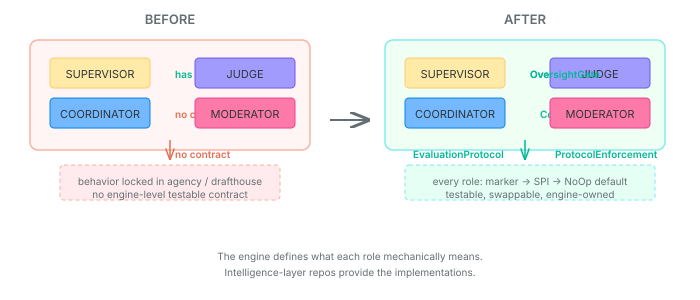
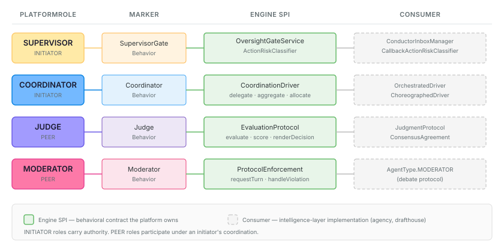

# Vocabulary without contracts is just naming

`PlatformRole` has four values: SUPERVISOR, COORDINATOR, JUDGE, MODERATOR. Each claims the platform implements specific behavior for that role. Until recently, only one of them was telling the truth.

SUPERVISOR had `OversightGateService` and `ActionRiskClassifier` — real SPIs with real contracts, real tests, real NoOp defaults. When a consumer repo implemented supervisor behavior, there was a well-defined interface it implemented. The engine could verify compliance, swap implementations, test in isolation.

COORDINATOR, JUDGE, and MODERATOR were vocabulary without contracts. The behavioral semantics lived in agency (`OrchestratedDriver`, `JudgmentProtocol`, `ConsensusAgreement`) and drafthouse (`AgentType.SELECTOR`, `AgentType.MODERATOR`). These are intelligence-layer implementations — they use LLMs, manage debate protocols, coordinate voting. Valuable work. But the engine-level mechanical contract — the thing that says what these roles *mean* at the platform level — didn't exist.

That's the gap. The platform said "this agent is a JUDGE" without defining what a judge mechanically does. It's like declaring a Java interface with no methods.



## What "mechanical" means here

The distinction between mechanical and intelligent behavior is the key design decision. Consider what a JUDGE does:

**Mechanical:** given a subject and criteria, produce a score. Given multiple candidates, rank them. Given a set of evaluations, render a decision using a voting strategy (majority, consensus, threshold). These operations have well-defined inputs and outputs. They can be tested with deterministic data. They compose regardless of what produced the individual evaluations.

**Intelligent:** deciding *how* to evaluate. Reasoning about quality. Weighing evidence. Understanding context. Applying domain expertise to produce the assessment itself.

The engine owns the first category. The intelligence layer owns the second. `EvaluationProtocol` defines the mechanical contract:

```java
public interface EvaluationProtocol extends JudgeBehavior {
  Evaluation evaluate(
      EvaluationSubject subject, List<EvaluationCriteria> criteria);
  List<ScoredCandidate> score(
      List<EvaluationSubject> candidates, List<EvaluationCriteria> criteria);
  EvaluationDecision renderDecision(
      List<Evaluation> evaluations, VotingStrategy strategy);
  void onLifecycleEvent(EvaluationLifecycleEvent event);
}
```

Agency's `JudgmentProtocol` — the thing that actually uses an LLM to form judgments, projects channel state, coordinates multiple reviewers — becomes an implementation of this contract. The intelligence remains in agency. The contract moves to the engine.

The same split applies to MODERATOR. `ProtocolEnforcement` defines the mechanical contract: who may act when (`requestTurn`), what happens on violation (`handleViolation`), whether an agent is in compliance (`checkCompliance`). The intelligence — understanding conversational dynamics, adapting rules based on debate quality, deciding when to intervene — belongs to the consumer.

## The two-layer pattern

All four roles follow the same structural pattern now:



**Marker interface** in `model.coordination` — `CoordinatorBehavior`, `SupervisorGateBehavior`, `JudgeBehavior`, `ModeratorBehavior`. These carry no methods. They exist so that a component can declare *which* behavioral contract it participates in. The marker is the declaration; the SPI is the implementation.

**Engine SPI** — the behavioral contract. Four methods, each mapping to a specific mechanical capability of the role. Sealed result types where the outcome space is bounded (`EvaluationDecision` is Selected, Rejected, or Deferred — not `Object`). NoOp defaults that are safe to run when no implementation is configured.

**Consumer implementations** — the intelligence layer. Agency provides `CoordinationDriver` implementations that use LLM-driven orchestration. Drafthouse provides `ProtocolEnforcement` implementations that manage debate protocols. These live in their own repos, as they should.

## Why sealed types earn their keep

Every result type in these SPIs is sealed: `EvaluationDecision` (Selected / Rejected / Deferred), `TurnDecision` (Permitted / Denied / Deferred), `ViolationResponse` (Warned / Blocked / Ejected), `CoordinationResult` (Aggregated / Partial / Failed).

Sealed types are not just type-safety decoration. They answer a specific engineering question: *what can happen?* When the engine receives a `ViolationResponse`, it knows exhaustively that the moderator either warned, blocked, or ejected the agent. A switch expression handles all three. If the SPI adds a fourth response type in the future, every consumer gets a compile error.

This matters for multi-agent coordination because the engine has to reason about outcomes. If a turn request is denied, the engine must queue the agent. If a violation results in ejection, the engine must remove the agent from the topology. These are mechanical consequences that follow from bounded result types. An `Object` return would push that reasoning into runtime type checks and hope.

## Mode-awareness in enforcement

`TurnRequest` carries a `CommunicationMode` — `STIGMERGY`, `DIRECT_MESSAGING`, `BROADCAST`, `GROUP_CHANNEL`. The moderator's enforcement rules depend on the communication mode. Turn-taking rules that make sense in a broadcast channel (one speaker at a time) don't apply in stigmergy (agents read shared state, no turns). An `InteractionRule` with severity `MANDATORY` in a broadcast context might be `ADVISORY` in a direct-messaging context.

This is the moderator earning its platform-role status: it enforces topology-aware rules, not just generic interaction constraints. The `CommunicationMode` on the request gives the moderator the context it needs to make mode-appropriate decisions.

## What changes for consumers

If you're building agent coordination on top of the engine, the practical change is straightforward: implement the SPI instead of rolling your own interface. Agency's `OrchestratedDriver` becomes a `CoordinationDriver`. Agency's voting infrastructure maps onto `EvaluationProtocol`. Drafthouse's debate moderator becomes a `ProtocolEnforcement`.

The engine provides NoOp defaults for each SPI — they're safe, permissive, and do nothing interesting. A system with no configured evaluator still runs; evaluations return score 0.0 with "no evaluator configured" as rationale. A system with no moderator permits all turns. This means adopting these SPIs is additive: existing behavior is unchanged until a consumer provides a real implementation.

The engine can also start validating at startup: if an agent is assigned `PlatformRole.JUDGE` but no `EvaluationProtocol` implementation is registered, that's a configuration warning worth surfacing. Vocabulary claims are now verifiable against actual behavioral contracts.

## The pattern beneath the pattern

Step back and the design principle is general: if a vocabulary type claims the platform does something, there should be a testable contract defining what that thing mechanically means. An enum value is a promise. An SPI is the fulfillment. Everything between is wishful thinking.
